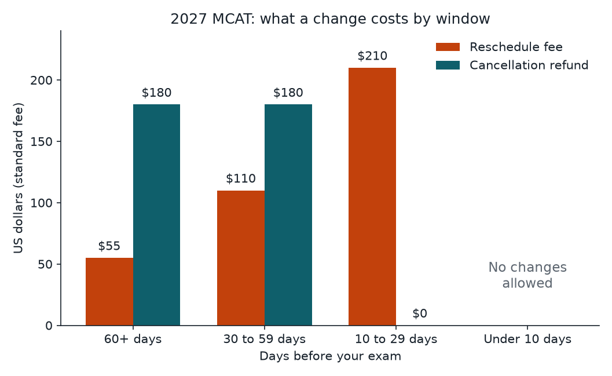

**Short answer:** Registration for every January to September 2027 MCAT date is open now through the AAMC's MCAT Registration System (MRS). Standard registration costs $360 ($145 with the Fee Assistance Program). The cheapest time to change your date is 60 or more days out, no refund exists inside 30 days, and nothing can be changed in the last 10 days before your exam.

## Registration is open: what that means

The AAMC's registration page says it plainly: "Registration is now open for all January-September 2027 MCAT exam dates!" ([AAMC: Register for the MCAT Exam](https://students-residents.aamc.org/register-mcat-exam/register-mcat-exam)). Every 2027 seat is bookable today. That matters because seats at popular centers and on popular dates go first, and an open date on the calendar does not mean an open seat near you.

You can search test centers without logging in, but a center showing up in the search does not guarantee it has a seat. The only way to see real availability is to log in to the MRS at mcat.aamc.org/mrs and look.

If your preferred date or location is full, the AAMC offers an MCAT Appointment Notification Request, which emails you when a seat opens at a date or location you choose. Test takers who need accommodations use a separate scheduling page on the AAMC site.

## How to register, step by step

1. Sign in to the MCAT Registration System at mcat.aamc.org/mrs with your AAMC account.
2. Search dates and centers. Check two or three backup dates before you commit.
3. Pay the registration fee. If you are approved for the Fee Assistance Program, the discounted fee applies.
4. Write down three deadlines for your date: the 60-day, 30-day and 10-day marks. These decide what any later change costs you.

## 2027 MCAT fees

These come from the AAMC's fee page, which applies them to all 2027 testing dates ([AAMC: MCAT Scheduling Fees](https://students-residents.aamc.org/register-mcat-exam/mcat-scheduling-fees)).

| Item | Standard | Fee Assistance Program |
|---|---|---|
| Registration | $360 | $145 |
| International fee (outside the US, Canada and US Territories) | $130 added | $130 added |

The international fee is added on top of registration and is not refunded if you cancel.

## The three change windows

Every change is priced by how many days remain before your exam:

| Days before exam | Reschedule fee | Cancellation refund | FAP reschedule | FAP refund |
|---|---|---|---|---|
| 60 or more | $55 | $180 | $25 | $75 |
| 30 to 59 | $110 | $180 | $45 | $75 |
| 10 to 29 | $210 | $0 | $85 | $0 |
| Fewer than 10 | No changes | No changes | No changes | No changes |

Two things stand out. First, the cancellation refund is the same $180 at 60+ days and at 30 to 59 days, so if you think you might cancel, the hard deadline is the 30-day mark, not the 60-day mark. Second, a reschedule costs almost four times as much inside 30 days ($210) as it does at 60+ days ($55). Ten days before the exam is also the last day to schedule a new appointment.

Deadlines fall at 11:59 p.m. in the local time of your test center, not your home time zone.

## 2027 US test dates and score release

Scores come out by 5:00 p.m. ET on the release date. Dates marked with an asterisk are offered at select US test centers only ([AAMC: US MCAT Calendar](https://students-residents.aamc.org/register-mcat-exam/us-mcat-calendar-scheduling-deadlines-and-score-release-dates-0)).

| Test date | Score release |
|---|---|
| Jan 15, Jan 16 | Feb 16 |
| Jan 21 | Feb 23 |
| Jan 29, Jan 30* | Mar 2 |
| Feb 12 | Mar 16 |
| Mar 6 | Apr 6 |
| Mar 19 | Apr 20 |
| Apr 9, Apr 10 | May 11 |
| Apr 16, Apr 17 | May 18 |
| May 1 | Jun 2 |
| May 7, May 8 | Jun 8 |
| May 13, May 14* | Jun 15 |
| May 21 | Jun 23 |
| May 29 | Jun 29 |
| Jun 11, Jun 12 | Jul 13 |
| Jun 25, Jun 26 | Jul 27 |
| Jul 9*, Jul 10 | Aug 10 |
| Jul 23 | Aug 24 |
| Jul 30 | Aug 31 |
| Aug 14 | Sep 14 |
| Aug 20, Aug 21 | Sep 21 |
| Aug 28* | Sep 28 |
| Sep 2, Sep 3 | Oct 5 |
| Sep 10, Sep 11 | Oct 12 |

Canada and international test takers have their own calendars on the AAMC site; check yours there.

## Picking a date: work backward

Start from the day you want a score in hand, not from the day you feel ready. Find that release date in the table, then read across to the test date. Then ask two questions:

- **Is there a backup?** Pick a date with a later date behind it that still releases in time. If a practice test goes badly, you want a move that costs $55, not a cancellation.
- **When is my 60-day mark?** Put it in your calendar the day you register. That is your last cheap decision point.

Pairs like Jan 15 and Jan 16, or Apr 9 and Apr 10, share one release date. If you can choose, the later day of the pair gives you one more study day at no cost to your score timing.

## Worked example: a January 15, 2027 exam

The AAMC calendar lists these deadlines for January 15, 2027:

- **60-day deadline: November 16, 2026.** Until then a reschedule costs $55 and a cancellation refunds $180.
- **30-day deadline: December 16, 2026.** Until then a reschedule costs $110; the refund is still $180.
- **10-day deadline: January 5, 2027.** Until then a reschedule costs $210 and a cancellation refunds nothing. After it, no changes at all.
- **Score release: February 16, 2027**, by 5:00 p.m. ET.

So a student booked for January 15 who is unsure should decide by November 16 if they want the cheapest move, and by December 16 at the latest if cancelling is on the table.

## Common mistakes

- **Treating a listed center as a seat.** Search results are not availability. Log in to the MRS.
- **Missing the 30-day mark.** After it, a cancellation returns $0.
- **Using your home time zone.** Deadlines are 11:59 p.m. local test center time.
- **Forgetting the international fee.** It is $130 on top of registration and is not refunded.
- **Guessing score dates.** Use the table above or the AAMC calendar for your exact date.

## Questions about your registration

The AAMC MCAT team answers by phone at 202-828-0600, Monday to Friday, 9 a.m. to 7 p.m. ET (closed Wednesdays 3 to 5 p.m. ET).

## One-minute recap

Register in the MRS now; all January to September 2027 dates are open. Standard registration is $360 ($145 with FAP). Changes cost $55 at 60+ days, $110 at 30 to 59 days and $210 at 10 to 29 days; the $180 refund disappears at the 30-day mark, and nothing changes inside 10 days. Pick your test date backward from the score release you need, and calendar your 60-day mark the day you book.

:::quiz
Q: What does a standard 2027 MCAT reschedule cost 45 days before the exam?
A: $110. The 30 to 59 day window charges $110 ($45 with FAP).
Q: Is there a cancellation refund 20 days before the exam?
A: No. Inside the 10 to 29 day window the refund is $0; the $180 refund ends at the 30-day mark.
Q: Can you reschedule 7 days before your exam?
A: No. No changes are allowed fewer than 10 days before the exam.
Q: When do scores for a January 15, 2027 exam come out?
A: February 16, 2027, by 5:00 p.m. ET.
Q: Whose time zone sets a change deadline?
A: The test center's. Deadlines fall at 11:59 p.m. local test center time.
:::

## Sources

- AAMC, Register for the MCAT Exam: https://students-residents.aamc.org/register-mcat-exam/register-mcat-exam
- AAMC, MCAT Scheduling Fees: https://students-residents.aamc.org/register-mcat-exam/mcat-scheduling-fees
- AAMC, US MCAT Calendar, Scheduling Deadlines and Score Release Dates: https://students-residents.aamc.org/register-mcat-exam/us-mcat-calendar-scheduling-deadlines-and-score-release-dates-0
